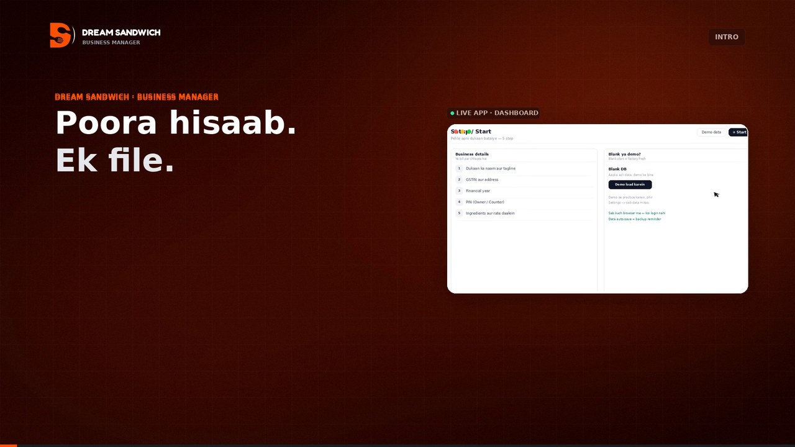

<p align="center">
  
</p>

<h1 align="center">Dream Sandwich — Business Manager</h1>

<p align="center"><b>Bakery · Store / Stall · Marketing Supply</b> — ek hi HTML file me pura hisaab.<br>
GST bill · udhaar khata · stock · production · staff salary · reports</p>

<p align="center">
  <a href="tutorial.mp4"></a>
</p>

<p align="center">
  
</p>

<p align="center">
  <b>Tally-style double-entry (Dr = Cr har waqt)</b> · Hinglish UI · browser me auto-save<br>
  Mobile · tablet · laptop · desktop — sab pe same file · **v9.2.0**
</p>

---

**Brand:** [facebook.com/dreamsandwichbetul](https://facebook.com/dreamsandwichbetul) · [instagram.com/dreamsandwichbetul](https://instagram.com/dreamsandwichbetul)

## 🎬 Tutorial video + in-app help

| Cheez | Kahan |
|---|---|
| Video file | `tutorial.mp4` (1:41, 1920×1080 cinematic, Hinglish voiceover) |
| Poster / thumbnail | `tutorial-poster.jpg` |
| App ke andar | Sidebar ke neeche **🎬 Tutorial dekhein**, ya **Masters → Settings → Tutorial & help** |
| Popup me kya | Video player + 10 chapter list + 6-step quick start |
| Video na mile to | App normal chalta hai — popup me chapter list + steps dikhte hain |

Video ka content (chapter time ke saath): 0:00 Intro · 0:12 Setup · 0:22 Costing + combo · 0:32 Kal ka Plan · 0:42 Bill (discount/round-off/loyalty) · 0:52 Udhaar bill-wise · 1:02 Purchase return · 1:11 Reports P&L/GST/GSTR-1 · 1:22 **Mobile menu fix** · 1:31 Backup + socials.

Brand: logo + mascot aapke original artwork se; outro me **facebook.com/dreamsandwichbetul** aur **instagram.com/dreamsandwichbetul**.

## 📱 Mobile / device support

| Device / OS | Status | Note |
|---|---|---|
| Android (Chrome, Edge, Samsung Internet) | ✅ | hamburger drawer, numeric keypad, bade tap targets |
| iPhone / iPad (Safari, Chrome) | ✅ | notch safe-area, 16px inputs (auto-zoom band), swipe scroll |
| Windows (Chrome/Edge/Firefox) | ✅ | sidebar always visible, keyboard focus rings |
| macOS (Safari/Chrome) | ✅ | same as above |
| Linux (Firefox/Chromium) | ✅ | — |
| Tablet (portrait/landscape) | ✅ | tabs scroll, tables horizontally scroll |
| Desktop print (A4) | ✅ | bill, report, barcode labels |
| Purana browser (ES6+) | ✅ | koi modern-only syntax nahi (`?.`, `??` use nahi hue) |

### 3-line (☰) menu ka behaviour — naya fix
- ☰ tap karein → **sidebar drawer khulta hai** (peeche halka scrim).
- Koi bhi option chunein → **screen change + menu turant band** ✅
- Scrim (bahar) tap → band · **Esc** → band · phone ghumayein/resize → khud band.
- Icon open hone par **✕** ban jata hai, aur khulte waqt background scroll lock ho jata hai (iOS pe page peeche nahi khisakta).

---

## 🧩 Kya-kya hai (40 screens)

**Dashboard** — aaj ka sale, cash position, top products, alerts.

**Per Day** — Day Register · Kya Chahiye (ingredient requirement) · Kal ka Plan (demand-based production) · Cash Book.

**Bakery** — Recipe & Cost (ingredient-level costing) · Production (batch, expiry) · Batch/Expiry + ingredient ageing · Sales.

**Store / Stall** — Counter Sales · Purchase & Stock (+ purchase return) · Purchase Orders · Vendor Payment · Wastage & Adjust.

**Marketing Supply** — Orders (optional flow) · Supply Bills · Demand · Payments (agent collection).

**Bahi Khata** — Khata/Ledger (party-wise) · Trial Balance · Day Book.

**Reports** — Profit & Loss (vertical-wise) · Product P&L · Udhaar/Party · Ageing (invoice-wise, write-off) · Stock · GST · **GSTR-1 / HSN** (CSV) · Reminders.

**Expenses & Staff** — Expenses (+ recurring auto) · Month-wise · Staff & Salary · Attendance (P / L / H / A) · Assets & EMI.

**Masters** — Setup · Ingredients & Rate · Party Rate List · Barcode Labels · CSV Import · Settings & Backup (PIN, billing rules, audit trail).

---

## 🔍 Faisla lene wale numbers (jo app khud nikalta hai)

- **Ingredient-level costing**: recipe → per-piece cost → margin, wastage, packaging, labour, overhead — sab formula se.
- **Combo products**: 2-3 product ek price me; stock har component ka katega, cost auto add.
- **Recipe variance**: production ke baad actual vs theoretical usage.
- **GST**: B2B/B2C split, rate-wise CGST/SGST, HSN-wise taxable — CA ko seedha CSV.
- **Invoice-wise settlement**: kis bill ka kitna paisa baki, exact ageing (0-30 / 31-60 / 60+).
- **Credit note / return**: sales return aur purchase return — stock, GST, P&L, udhaar sab net ho jata hai.
- **Bad debt write-off**: jo paisa aayega nahi — Bad Debt expense, party khata band.
- **Loyalty**: bill par points, agle bill me max 30% tak redeem.
- **Assets & EMI**: machine/fridge ki EMI har mahine apne aap kharcha.

---

## 🧮 Hisaab ka bharosa

Har build pe automated check chalta hai:

- **Trial Balance Dr = Cr**, difference **₹0.00** (blank aur demo dono)
- P&L ↔ GST ↔ stock consistent (return, purchase return, write-off, EMI, recurring post ke baad bhi)
- 40 screens × (blank DB + demo DB) = **80 view renders, 0 error**
- Table colspan / tag balance check — **0 issue**

---

## 🌐 GitHub Pages pe host karna (optional)

1. Repo → **Settings → Pages**
2. Source: **Deploy from a branch** → Branch: `main`, folder: `/ (root)`
3. Save — 1 minute me `https://<username>.github.io/<repo>/` pe app live.
4. Phone me kholke **"Add to Home Screen"** karein — icon ban jayega (offline bhi chalega, kyunki sab kuch ek file me hai).

> Data browser ke localStorage me rehta hai — **per device**. Phone aur laptop ka data alag rahega; **Settings → Backup** se JSON leke doosre device pe Restore kar lein.

---

## 🛠 Developer ke liye (source se build)

```bash
bash build.sh          # src/* ko jodkar index.html banata hai
```

```
.
├── index.html                 # built app (yahi deploy hoti hai)
├── tutorial.mp4               # 1:41 cinematic demo (app ke popup me chalti hai)
├── docs/video/                # video ke source scripts (cinematic.py, scenes.py, assemble.py)
├── tutorial-poster.jpg        # video thumbnail
├── build.sh                   # cat-based build
├── src/                       # 24 source parts (build order me)
│   ├── 01_head.html           # CSS + layout + device hardening
│   ├── 02_util.js ... 23_final_c.js
│   └── 11_boot.js, 99_tail.html
├── docs/
│   ├── Dream-Sandwich-Guide.md
│   └── Dream-Sandwich-Roadmap.md
├── CHANGELOG.md
└── LICENSE (MIT)
```

Koi bundler, npm, dependency nahi — sirf plain HTML/CSS/JS.

---

## 🎨 Brand

**Icon:** aapka original mark (unchanged) — `D` + spoon + fork ka negative space, upar `S` ka curve, saath white arc. **Wordmark:** **Fredoka Bold** (garam, food-brand feel) + Poppins body.

| Cheez | Value |
|---|---|
| Orange | `#FB5105` |
| **Dark brown** (black ki jagah) | `#1D0200` |
| Card brown | `#2B0A05` |
| Cream | `#FFF7EF` |
| Wordmark type | **Anurati** (sirf brand naam) |
| Body type | **Poppins** |

### Files
| File | Use |
|---|---|
| `assets/icon-transparent.png` · `icon-tile.png` | icon (transparent / brown tile) |
| `assets/lockup-dark.png` · `lockup-light.png` | icon + `DREAM` (orange box) + `SANDWICH` |
| `assets/appicon-512/192/180/64.png` | app icon, favicon, Apple touch (brown tile) |
| `assets/01-profile-1080.png` … `10-brand-system.png` | **poora social kit** (FB profile, cover, post, IG post, story, reel cover, highlight, pattern, menu card, brand sheet) |
| `assets/brand5.py` | icon variants + lockup generator (`python3 brand5.py`) |
| `assets/kit5.py` | 10-image social kit generator |
| `assets/refsheet.py` | alignment proof + overview sheets |

App ke andar icon **inline (base64)** hai — favicon + Apple touch + sidebar logo, teeno offline. Theme colour `#1D0200`.

## ⚠️ Sach baat

- Data **local** hai (browser storage). Browser data clear kiya to data gaya — **backup reminder** app khud deta hai, phir bhi mahine me ek baar JSON backup lein.
- PIN sirf **local lock** hai (casual access rokta hai, asli security nahi).
- Multi-branch (branch-wise stock/report) is version me nahi hai.
- Tutorial video 2:31 min hai — 40 screens ka poora detail guide `docs/Dream-Sandwich-Guide.md` me hai.

---

## 📄 License

MIT — apne business ke liye free use, modify, distribute. Details: [LICENSE](LICENSE).
